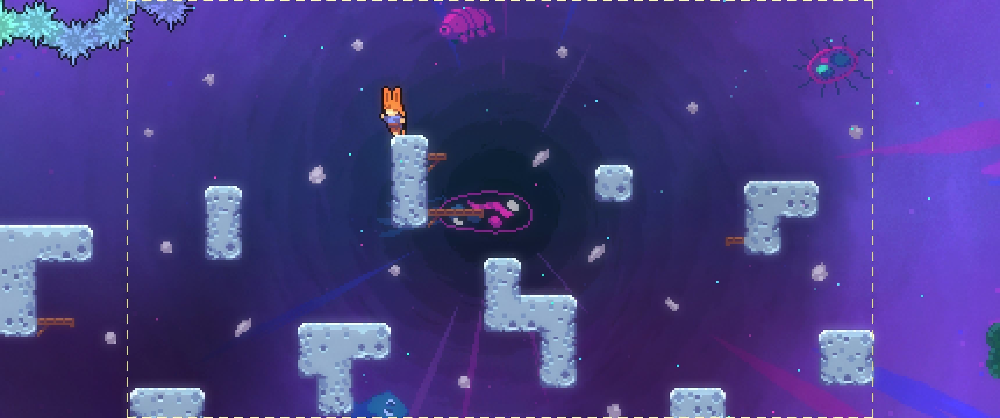
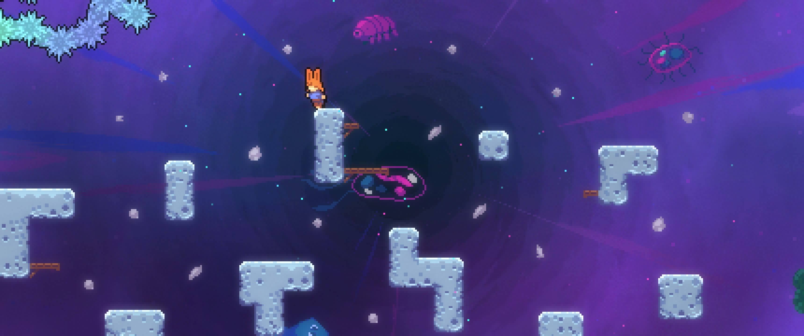

# Ultrawide Toggle

Play Celeste in ultrawide and wider while preserving the original 16:9 gameplay camera.
Choose separate aspect ratios for gameplay and the main menu, switch views with
keyboard or controller shortcuts, and see the original frame with a customizable
boundary overlay.

**[Download and Install on GameBanana](https://maddie480.ovh/celeste/gb?id=UltrawideToggle)**
  [Report a Bug](https://github.com/Denis-Gamolya/Celeste-Ultrawide-Toggle/issues)
  [MIT License](LICENSE)

Download the mod from GameBanana using the link above. GitHub's **Download ZIP**
contains source code, not the installable mod.



## Why this mod exists

Moving the game camera's edge moves camera-based projectile spawns.
With an extended camera view this can cause entities to spawn further than intended.
This mod keeps the original simulation camera and extends the rendered view around it.
That makes the extra scenery visible while preserving original camera rules.

A projectile may appear inside the extra visible area: its original spawn point
is now on screen. This mod does not spawn projectiles early or predict them.

## Features

- **Independent gameplay and menu aspects:** 16:9, Auto, 21:9, 32:9, and 48:9.
- **Direct keyboard and controller shortcuts:** Toggle 16:9, Toggle Auto,
  Toggle 21:9, Toggle 32:9, or Toggle 48:9
- **Original entity rules:** vanilla snowball spawn/reset, Oshiro attack
  boundaries, and Badeline shot lifetime are preserved
- **Per-room 16:9 overrides:** Can remember specific rooms that should always use 16:9
- **Configurable 16:9 boundary:** five colors, seven thicknesses, contrasting
  outlines, opacity, three border styles, and extended view dimming
- **Ultrawide presentation fixes:** aligned berry/timer HUD, world prompts,
  spinner visibility, Farewell backgrounds, menus, and exit transitions.

## Screenshots

The same Farewell scene in ultrawide, with and without the 16:9 overlay.
The custom character skin shown is not included.

| Ultrawide | Ultrawide with overlay |
| --- | --- |
|  |  |

## Installation

Requires **Celeste with Everest 1.6580.0 or newer**. Tested on Windows with
Celeste 1.4.0.0 and Everest build 6580. Current mod version: **1.0.2**.

1. Open the [GameBanana download page](https://maddie480.ovh/celeste/gb?id=UltrawideToggle).
2. Use its **Olympus / Everest one-click install** button. For manual installation,
   close Celeste and place `UltrawideToggle-1.0.2.zip` in the game's `Mods` folder.
   Keep the ZIP zipped.
3. Launch Celeste and open **Mod Options > Ultrawide Toggle**.
4. Choose your **Gameplay Aspect Ratio** and **Main Menu Aspect Ratio**.

This mod is not compatible with separate standalone ultrawide patchers.
If an ultrawide patcher is already applied it must be removed to prevent
unintended conflicts.

To uninstall, close Celeste and remove the mod ZIP from `Mods`.

## Aspect ratios and controls

| Setting | Behavior |
| --- | --- |
| **16:9** | Original framing. Gameplay defaults to this. |
| **Auto** | Follows the current display/window ratio, within 16:9 to 48:9. Menus default to Auto. |
| **21:9** | Follows common 2560x1080, 3440x1440, and 3840x1600 display shapes; otherwise uses literal 21:9. |
| **32:9 / 48:9** | Uses the selected wider aspect. |

**Keyboard Config** and **Controller Config**
A shortcut selects its aspect directly; pressing it again keeps that aspect.
Bind **Toggle 16:9** to return to the original view.

**Always Use 16:9 in This Room** overrides your gameplay aspect only in that
room. This is saved and applied if you re-enter a room.

## 16:9 boundary

Expand **16:9 Boundary** to adjust the reference frame. Turning it off retains
your appearance settings. It is hidden during 16:9 gameplay and outgoing wipes.

| Control | Options |
| --- | --- |
| Enabled | On / Off |
| Color | Yellow, White, Black, Cyan, Magenta |
| Thickness | 1, 2, 3, 4, 6, 8, 12 px |
| Outline | Off, Black, White, Auto |
| Opacity | 25%, 50%, 75%, 100% |
| Border Style | Solid, Dashed, Corners Only |
| Dim Outside 16:9 | 0% to 100%, in 10% steps |

Auto chooses a contrasting black or white outline. Thickness uses the game's
1080-high HUD coordinates and scales with the output. Dimming affects only the
extra side areas.

## Compatibility

- Zoomed/rotated cameras, cutscenes, mirror assist, screen padding, and custom
  camera viewports/origins temporarily use 16:9. Normal room scrolling stays wide.
- Some maps have unfinished scenery beyond their intended view.
- Restart the room to apply entity rule changes
- Other operating systems have not been validated.

## Development

Clone into `<Celeste>/ModDevelopment/UltrawideToggle` alongside a local Everest
installation. Game assemblies are referenced locally and are not redistributed.
With a .NET SDK installed, run:

```powershell
./build.ps1 -Offline
./test.ps1
```

The offline build uses the .NET 8 runtime supplied by the tested Everest install
when reference packs are unavailable. The automated suite passes **1,954
assertions**; that does not replace visual checks on each rendering setup.

See [development and architecture](docs/Development.md) and
[release history](CHANGELOG.md).

## Credits and license

- **[Areht](https://gamebanana.com/members/1789526):**
  Implementation, debugging, documentation
- **[Codex](https://openai.com/codex/):**
  regression testing, documentation, and release preparation.
- **[EverestAPI contributors](https://everestapi.github.io/):** modding platform
  and [documentation](https://github.com/EverestAPI/Resources/wiki).
- **[MonoMod contributors](https://github.com/MonoMod/MonoMod):** runtime hooking
  tools used through Everest.
- **[RoseTheFlower](https://github.com/RoseTheFlower/UltrawideIndex/releases/tag/celeste):**
  Insperation by this ultrawide patcher for Celeste

Original mod source is available under the [MIT license](LICENSE).
