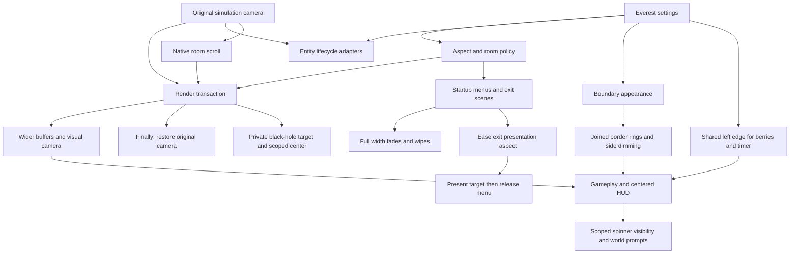

# Development

## Architecture



The black-hole adapter uses the same scoped-state pattern for its visual center
and keeps its private target separate from persistent lighting caches. Weak
references avoid retaining backdrops after their scenes end; native backdrop
cleanup owns the active target. Live targets return to native width on unload.

The render transaction is a scoped-state pattern. An explicit IL allowlist
patches rendering dimensions; the original camera remains authoritative in
simulation. This avoids the original patch's magic-number replacements in
gameplay calculations. Hook installation verifies expected occurrence counts
and rolls back a partially installed set if a method shape changes.

The centered HUD formerly exposed the berry panel's nominally off-screen
animation in the extra side area. Berries and the timer now use the same
visible left edge while retaining their vanilla easing and vertical layout.
Wide views use Everest's direct HUD rendering path to avoid clipping against
its fixed-width intermediate target in small windows. Interface changes live
in a separate checked hook set rather than broad gameplay constant edits.

Width changes replace only screen-sized buffers. The fixed-size lighting
atlas retains its texture and light-index cache, as do the lightning and
speed-ring targets. Replacing resolution-independent caches during a view
change was a temporal-coupling bug in 0.1.0: clean lights would still point at
an empty atlas until a room reload. The resize transaction now allocates all
replacements before committing and preserves the game's target ownership list.

This small C# code-mod layout follows the official Everest module/template
structure and the separation used by ExtendedVariantMode: module/settings,
render controller, checked hooks, deterministic math, and tests. Mermaid is
used because GitHub and the review UI render versionable Markdown diagrams.

## Build and package

Requires .NET SDK, a local Celeste/Everest install, and net8.0 targeting assets.
For the supplied scripts, clone into <Celeste>/ModDevelopment/UltrawideToggle.
The default GameDirectory is two directories above the project;
override it when building elsewhere.

```powershell
./build.ps1 -Offline
./test.ps1
```

Offline mode compiles against the .NET 8.0.15 runtime shipped with this game
when the net8.0 reference pack is unavailable. Release packages contain the mod DLL, metadata, dialog labels, MIT license,
README, and validation notes. Add `-Install` while Celeste is closed to
copy the ZIP into Mods. Remove that ZIP to uninstall.

